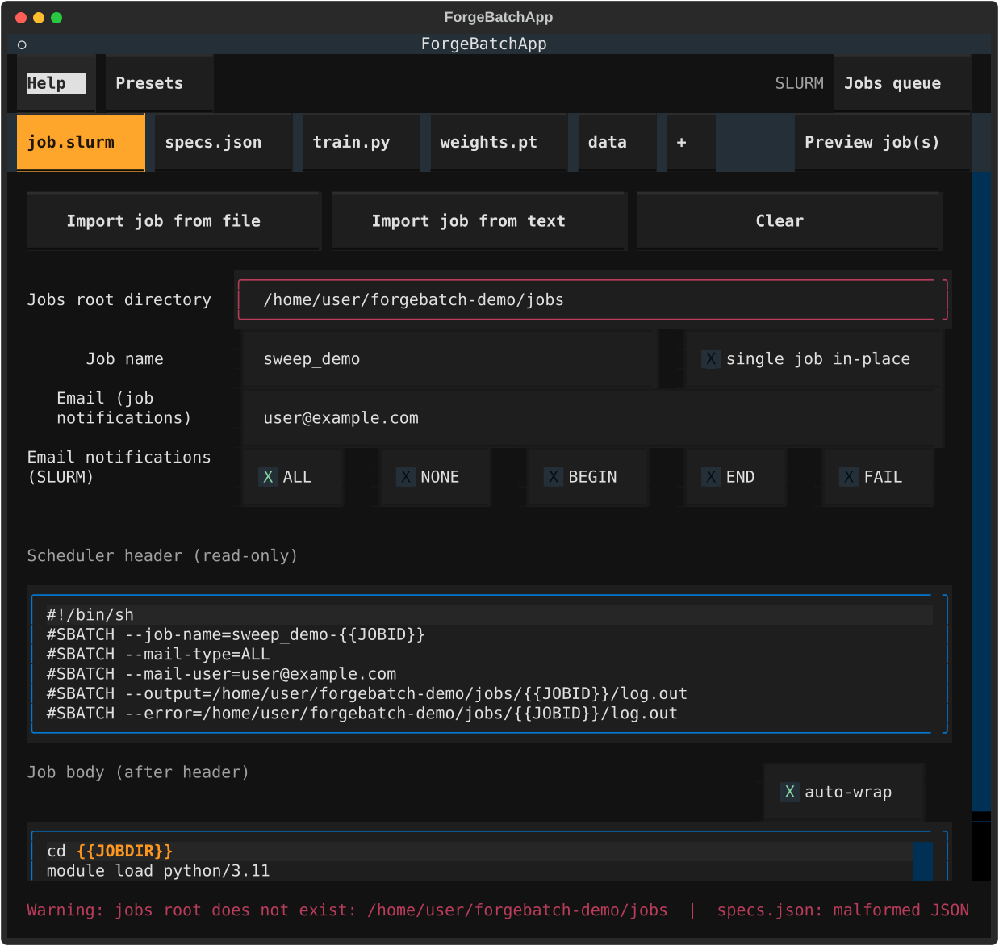
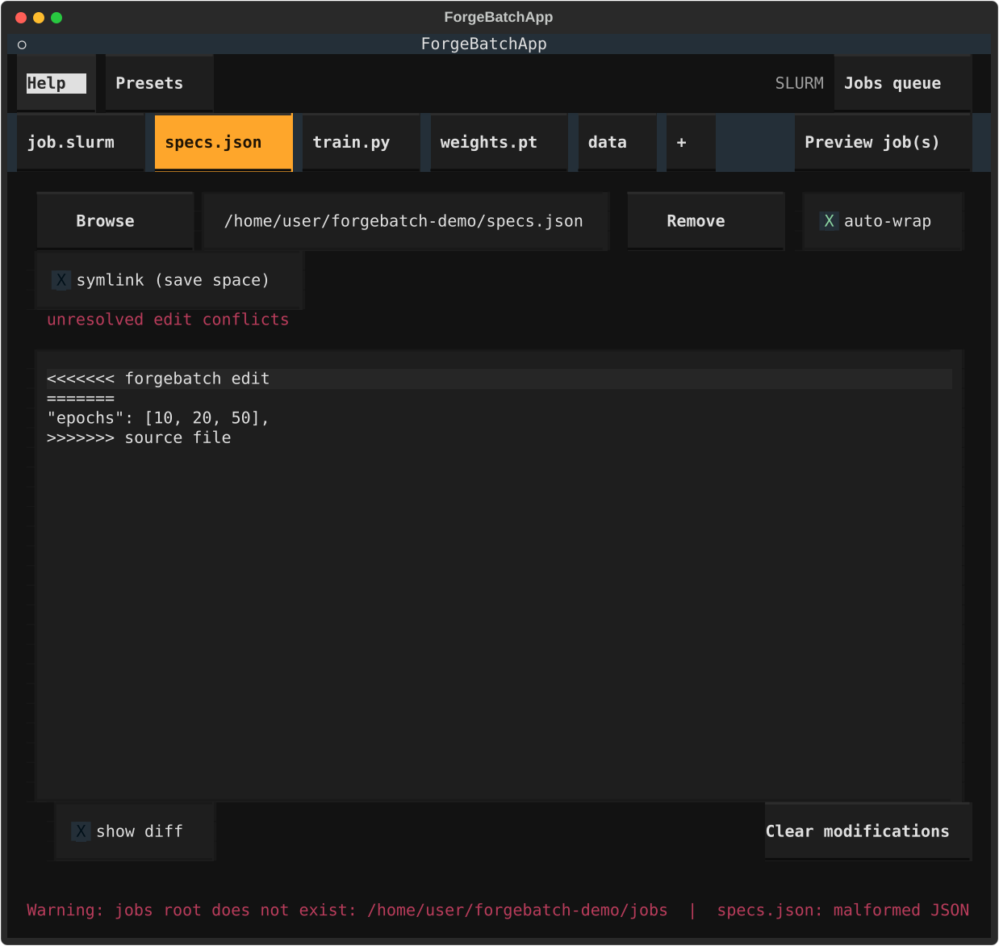
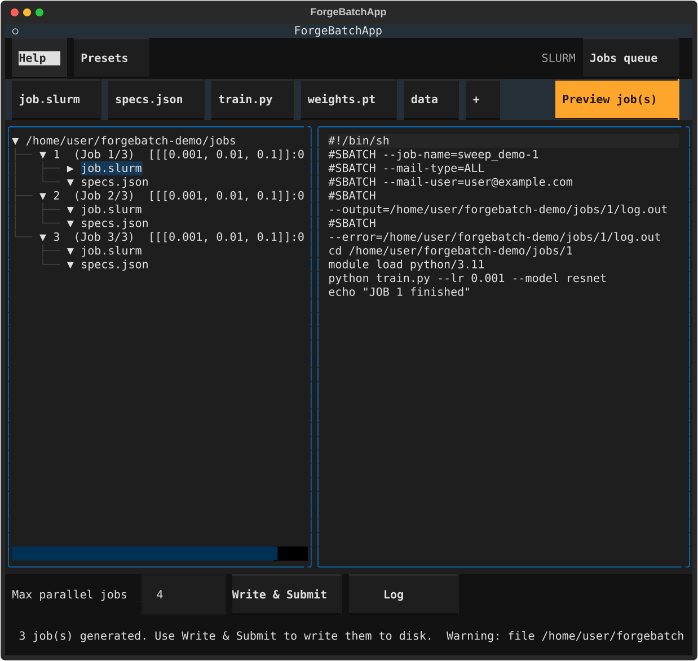
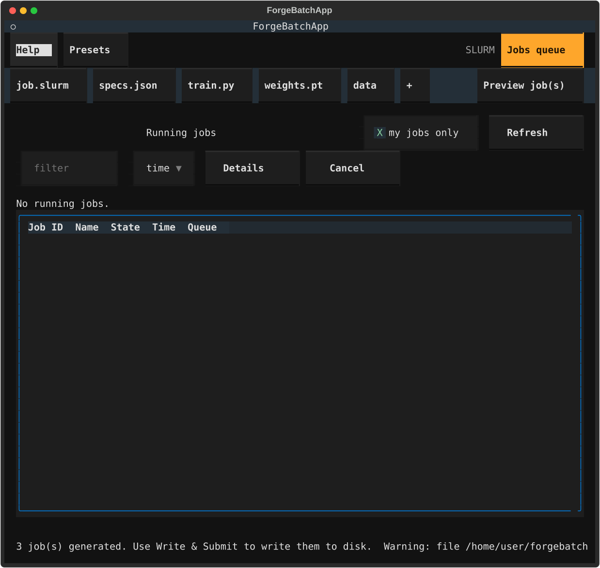

# forgebatch

An interactive Textual TUI that generates SLURM/PBS job directories for
HPC scheduler experiments.

## What it does

- Lets you configure job root, email and parallelism.
- Lets you assemble a list of arbitrary *included files* (the experiment
  `specs.json`, a script, data files, ...).
- Each included file can be **edited inline**; edits only ever affect the copy
  written into the generated job directory — the source file on disk is never
  modified. Edits are stored as **git-style diffs** (in `file_edits`) and
  **auto-saved** (debounced), so they are
  re-applied to the *current* file content on load/build. If the source file
  changed such that a saved edit no longer applies cleanly, the app merges
  what it can and exposes conflict markers in the editable pane.
- The **job body** (the content after the SLURM/PBS header) is filled in from
  an existing scheduler job with **Import job from file** or **Import job from
  text**, or typed directly in the editable **job body** pane. It is appended
  verbatim to the generated scheduler file after the header. The scheduler
  header itself is read-only. Included files are always copied, never embedded.
- Edits to included files are saved
  automatically (debounced) and on explicit **Ctrl+S**. They are stored
  as unified diffs, so a later change to the underlying source file can be
  merged or surfaced as a conflict rather than silently overwriting it.
- **Sweep**: express a sweep in either of two ways. In an included *data*
  file (`.json`, `.yaml` or `.yml`) that parses as a mapping, replace a key's
  single scalar with an array to sweep it — keys may be top-level or **nested**
  (a dotted path such as `data.random_linear_transform`). In the **job body**,
  write an inline `[[...]]` sweep containing a JSON array of scalars (e.g.
  `--lr [[0.001, 0.01, 0.1]]`). Both kinds become dimensions that combine via
  Cartesian product, producing one job directory per combination. Active sweeps
  are highlighted in the file/job-body editors; malformed data files and
  malformed `[[...]]` sweeps are flagged in the status bar.
- Preview the generated job tree interactively before writing, then
  Write & Submit them (buttons in the action bar).

## Screenshots









## Requirements

- Python 3.10+
- [Textual](https://github.com/Textualize/textual) (`pip install textual`)
- [PyYAML](https://pyyaml.org/) (`pip install pyyaml`) — required for YAML
  sweep support. If it is missing, `.yaml`/`.yml` files are treated as plain
  copies (no sweep) and a warning is shown in the status bar; JSON sweeps still
  work.

The scheduler type is auto-detected at startup by checking for scheduler
binaries: SLURM (`sbatch`/`srun`) produces `job.slurm`, PBS/Torque
(`qsub`/`qstat`) produces `job.pbs`. If neither is found, PBS output is used
and the app reports "No scheduler found".

## Run

From inside this directory:

    python3 forgebatch.py

(or from the parent: `python3 forgebatch/forgebatch.py`).

## Usage

Three tabs:

- **job.slurm / job.pbs** (named after the generated scheduler file) — job
  root, an optional **job name** (used as the scheduler `--job-name` / `-N`
  prefix; per-job ids are appended in multi-job mode), an optional **Single job
  in-place** mode (write one job directly in the job root with no numbered
  subdirectory and no sweep expansion), email, and a read-only
  scheduler header followed by an editable **job body** pane (the content
  placed after the header). **Import job from file** / **Import job from
  text** fill the body (and email) from an existing scheduler job; **Clear**
  resets the job root, email and body. If the **job root** directory does not
  exist yet, a **Create** button appears next to the field to create it (and is
  hidden once it exists). The SLURM email-notification type is a
  comma-separated `--mail-type` field (e.g. `ALL` or `BEGIN,FAIL`; events
  `ALL, NONE, BEGIN, END, FAIL, REQUEUE, TIME_LIMIT`), used when the email
  address is set.
- **Files** — `Add file` to include a path; each row has `Browse`, `Edit`
  and `Remove` buttons. Each included file is copied into the generated job
  directory. Files are editable inline (with an optional **show diff**
  side-by-side view); **binary** files are detected and not editable. Whole
  **directories** can be included too, and every item can be **copied or
  symlinked** into the job directory (symlink is the default for directories,
  copy for files; symlinked files are not editable).
- **Preview** — interactive tree of the generated jobs (select a node to view
  its content) plus a status line. If any write target already exists on disk
  and would be overwritten, a warning bar lists the conflicts and blocks
  writing until you press **Override conflicts** to write anyway.

A visible action bar below the header provides the main actions: **Help**,
**Preview**, **Write & Submit**, and **Presets**. The **Help** button opens
the in-app help (the same content as `help.md`). Settings and inline edits are
**autosaved** (and can be forced with **Ctrl+S**); press **Escape** or
**Ctrl+X** to quit (**Ctrl+X** works from any dialog). To paste text (e.g.
into the job body or the **Import job from text** dialog), use **Shift+Ctrl+V**
— the usual **Ctrl+V** does not work in the terminal.

## Typical workflow

A typical session goes like this:

1. **Set up the Settings tab.** Give a **Jobs root directory** (the base folder
   under which each generated job gets its own numbered subdirectory) and, if
   you want email notifications, your **email** address. Optionally set a
   **Job name** (used as the `--job-name` / `-N` prefix) or tick **Single job
   in-place** to write one job directly in the root. The read-only
   **scheduler header** updates as you type, so you can verify the `#SBATCH` /
   `#PBS` lines before anything is written.
 2. **Prepare the job body.** Use **Import job from file** (or **Import job
    from text**) to load an existing SLURM/PBS job: it populates the **email**
    field and the **job body** (the whole job after the header, with the
    header-owned fields removed). The body is placed right after the generated
    scheduler header. You can edit it inline directly. Use the
    `{{JOBID}}` / `{{JOBDIR}}` tokens anywhere in it; they are replaced per job
    when jobs are generated.
3. **Add your data files.** On the Files tab, press **+** (or Add file) for
   every file that should be copied into each generated job directory — for
   example your experiment's JSON/YAML parameters. Your source files are never
   modified; only the copies inside each job directory reflect your edits.
 4. **Express a sweep (optional).** Either replace a scalar value with an
    **array** in an included data file — e.g. `{ "CodeLength": [256, 128, 23] }`
    — or write an inline `[[...]]` sweep in the job body — e.g.
    `--lr [[0.001, 0.01, 0.1]]`. Every such sweep becomes a dimension and all
    dimensions combine via **Cartesian product**, so one job is generated per
    combination. The sweeps that will expand are highlighted in the editor.
5. **Inspect the results.** Open the **Preview** tab: an interactive tree shows
   every generated job directory; select any node to read the file. Confirm the
   header, the token substitutions and the sweep combinations all look right
   before writing anything to disk.
6. **Choose your concurrency.** In the Preview pane, set **Max parallel jobs**
   to control how many jobs run at once when you submit: `0` = no limit (all
   parallel), `1` = all in series, `N` = `N` parallel chains. Dependencies are
   created so each job in a chain waits for the previous one to succeed.
7. **Write & Submit.** Press **Write & Submit** to write the job directories to
   disk and launch them with the scheduler (`sbatch` for SLURM, `qsub` for
   PBS). If any target already exists and would be overwritten, the Preview
   pane blocks the write and lists the conflicts — resolve them or press
   **Override conflicts** to write anyway. Your settings are autosaved along
   the way.
8. **Follow up.** If any submission fails, a **log modal** opens with the
   details — use it to diagnose rejections. The **Jobs queue** tab lists your
   running scheduler jobs (colour-coded by state; filter,
   sort, and inspect or cancel individual jobs). Revisit **Log** in the
   Preview pane to reread the last submission's log at any time.
9. **Quit.** Press **Ctrl+X** (or **Escape**) to exit; your settings are
   already saved.

## Tokens

The job body accepts two placeholders, replaced per job when jobs are
generated:

- `{{JOBID}}` — the generated job's id.
- `{{JOBDIR}}` — the generated job's directory path.

Known tokens are highlighted in **yellow**; unknown tokens (typos) are
highlighted in **red** and reported in the status bar, clearing once fixed.

## Sweeps

There are two ways to express a sweep, and both feed the **same** Cartesian
product: one job is generated per combination of every sweep dimension.

### Data-file sweeps (JSON / YAML)

An included data file (`.json`, `.yaml` or `.yml`) is swept when a key's value
is an **array** that replaces a scalar. The on-disk source keeps the original
scalar; the sweep lives in the file's inline edit. Keys may be top-level or
**nested** (a dotted path). Text (string) values can be swept just like
numbers.

JSON — sweep `CodeLength` over 256, 128, 23:

```json
{ "CodeLength": [256, 128, 23] }
```

JSON — sweep `model` over the strings "resnet", "densenet", "unet":

```json
{ "model": ["resnet", "densenet", "unet"] }
```

YAML — sweep the nested `data.random_linear_transform`:

```yaml
data:
  random_linear_transform: [0.1, 0.3, 0.5]
```

Every array across every included data file becomes a dimension; all dimensions
combine via **Cartesian product**, producing one job per combination. Arrays
that are already arrays in the source (genuine data, e.g. a fixed list) are
**not** swept, and neither are arrays of mappings. Active sweep arrays are
highlighted in the file view.

### Job-body (script) sweeps — `[[...]]`

The job body itself can be swept by writing an inline `[[...]]` region
containing a **JSON array of scalar values** (numbers, strings, or `true` /
`false`). The `[[...]]` is a dimension just like a data-file array: each
generated job receives one value from the list, with the `[[...]]` replaced by
that value rendered **bare** (no quotes).

Example — sweep the learning rate over 0.001, 0.01 and 0.1:

```bash
python train.py --lr [[0.001, 0.01, 0.1]]
```

This generates one job per value, running `--lr 0.001`, `--lr 0.01` and
`--lr 0.1` respectively. Strings are substituted unquoted (e.g.
`--model [[resnet, densenet, unet]]` runs `--model resnet`, …) and booleans as
`true` / `false`.

Valid `[[...]]` sweeps are highlighted in **cyan** in the job-body editor;
**malformed** ones (invalid JSON, non-scalar contents, or an unclosed `[[`)
are highlighted in **red** and reported in the status bar until fixed.

Both kinds of sweep combine into the same Cartesian product — a data-file sweep
and a body sweep together produce one job per pair of values.

## Parallelism limit

In the Preview pane, next to **Write & Submit**, a **Max parallel jobs** field
limits how many jobs run **in parallel** when you submit:

- **0** (default) — no limit; all jobs can run in parallel.
- **1** — all jobs run in series (one chain).
- **N** — `N` parallel chains; within each chain jobs run in series, so at
  most `N` jobs run at once.

Dependencies are injected at submission time with the scheduler's dependency
mechanism — `--dependency=afterok:<id>` for SLURM, `-W depend=afterok:<id>` for
PBS — so each job in a chain starts only after the previous one succeeds. The
value is persisted with your settings.

## Submission log

After **Write & Submit**, a per-job **submission log** records each job's
command, exit code, and the scheduler's stdout/stderr (or the launch error).
When at least one job fails, a **log modal** opens automatically so you can see
why (e.g. an allocation error) instead of just a failed count. The log is also
written to `submit.log` under the job root directory. The **Log** button in the
Preview pane reopens the last submission's log anytime.

## Jobs queue

The **Jobs queue** tab lists the current OS user's active scheduler jobs,
showing each job's id, name, state and elapsed time. It queries
`squeue --format=%i|%u|%j|%T|%M|%l` on SLURM clusters or `qstat -x` (XML) on
PBS, then filters to the current user **client-side** when the "my jobs only"
checkbox is on. The `qstat -x` XML query preserves each job's **full,
untruncated id and name** (the plain `qstat` listing cuts them, which would
otherwise break `qstat -f` details and `qdel` cancellation on long hostnames).
Each row shows `JOBID NAME USER STATE ELAPSED QUEUE` as a single line,
**colour-coded by state** (green running, yellow pending, cyan completing,
magenta cancelled, red failed). Long job ids and names are **truncated for
display only** (Details and Cancel always use the full id), and the list is
**capped at 200 jobs** — when a queue has more, a "Showing first 200 of N
jobs" message notes the rest, keeping the list responsive on huge queues.
Type in the
**filter** box to narrow the rows, and use the **sort**
dropdown to order by id, name, state or time. Select a row and press
**Details** to view the full scheduler output (`scontrol show job` /
`qstat -f`) or **Cancel** to stop it (`scancel` / `qdel`). Press **Refresh**
(or open the tab) to update the list; it is updated manually (no automatic
polling). If no scheduler is detected, the pane reports "No scheduler found".

## Configuration

Settings are saved to `~/.config/forgebatch/config.json` (respects
`$XDG_CONFIG_HOME`). It stores the last settings and any presets (via the
`Presets` button, top left). Pass `-c/--config PATH` on the command
line to use a different configuration file.
Legacy configs that stored a `user` field are migrated to `email` on load.

## Layout

| File | Responsibility |
|------|----------------|
| `forgebatch.py` | Launcher entry point |
| `config.py` | Constants + settings/preset persistence |
| `fileio.py` | Shared Textual-free file-reading helper (binary detect + UTF-8) |
| `builder.py` | Pure job-generation logic, incl. sweeps (no Textual, unit-testable) |
| `diffing.py` | Pure diff/merge helpers for edit persistence (no Textual) |
| `runner.py` | Pure submission helpers + scheduler-output parsing into structured records (no Textual) |
| `widgets.py` | `FilePane` composite widget (incl. sweep-array highlighting) |
| `screens.py` | Modal screens (browse, editor, prompt, presets, help, submit log, job details, confirm) |
| `app.py` | `ForgeBatchApp` main tabbed UI + Preview pane |
| `tests/` | stdlib `unittest` suite |

See `AGENTS.md` for guidance aimed at coding agents.
